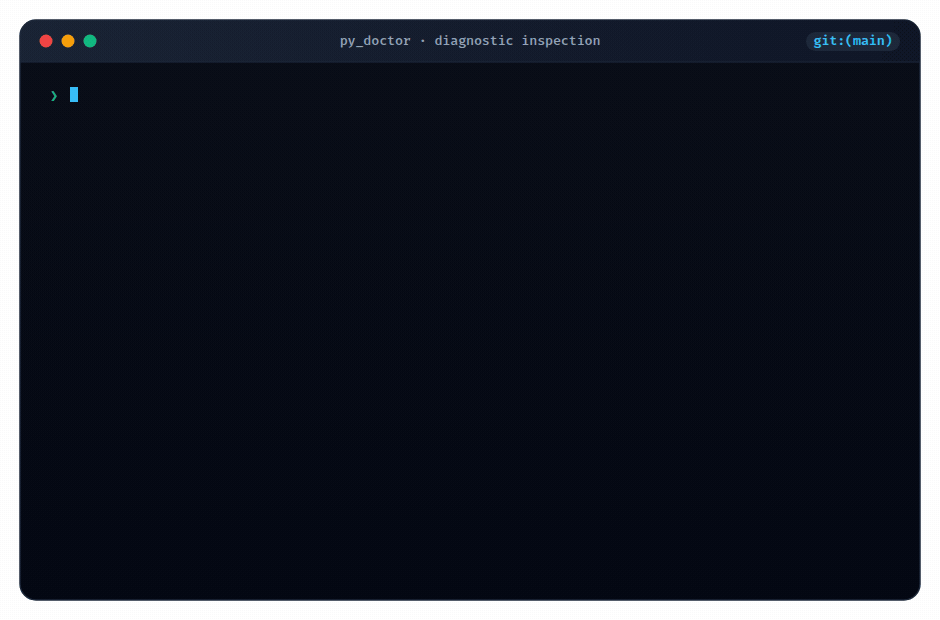

<div align="center">

<a href="https://github.com/aswin402/py_doctor">
  <picture>
    <source media="(prefers-color-scheme: dark)" srcset="assets/logo-animated.svg">
    
  </picture>
</a>

# 🩺 py_doctor

<h3>FastAPI Project Health Diagnostic &amp; AI Remediation Engine</h3>

<p><em>The backend health doctor for Python &amp; FastAPI — instant 0–100 health scoring, deep AST diagnostics, and one-click AI prompt generation.</em></p>

[](https://www.python.org/)
[](https://fastapi.tiangolo.com/)
[](LICENSE)
[](https://docs.astral.sh/uv/)
[](https://github.com/astral-sh/ruff)
[](https://pytest.org)
[](https://github.com/aswin402/py_doctor/issues)

<br/>

<a href="#-overview">Overview</a> •
<a href="#-what-it-checks">What It Checks</a> •
<a href="#-ai-agent-workflow-neededfixmd">AI Workflow</a> •
<a href="#-installation">Installation</a> •
<a href="#-usage--cli-options">CLI Options</a> •
<a href="#-configuration">Configuration</a> •
<a href="#-cicd--github-actions">CI/CD</a> •
<a href="#-architecture">Architecture</a>

</div>

---

## ⚡ Overview

**py_doctor** scans your entire FastAPI codebase for silent bugs, un-awaited coroutines, database connection leaks, missing response models, dead code, type mismatches, and vulnerable dependencies in seconds.

It outputs a clear **0–100 Health Score** in a terminal UI, supports machine-readable **JSON** and **Git diff** scanning for CI/CD, and generates a structured `NEEDEDFIX.md` file designed for immediate handoff to AI coding agents (Cursor, Claude Code, Copilot, Antigravity) to resolve all findings automatically.

<br/>

<div align="center">
  
</div>

<br/>

<details>
<summary><b>Click to expand raw terminal text output</b></summary>
  ❯ py_doctor . --verbose

  Detecting project...
  ✓ Python 3.12.3 · FastAPI 0.110.0 · SQLAlchemy 2.0.25
  ✓ Alembic detected · structlog detected · 34 source files

  ✓ Analysis complete

  ────────────────────────────────────────────────────────────────────────────

  ERRORS (2)

   ERR   fastapi/missing-await          app/routes/users.py:42
         db.execute() called without await — returns coroutine not result

   ERR   fastapi/hardcoded-secret       app/core/config.py:7
         SECRET_KEY hardcoded in source — use env var

  WARNINGS (2)

   WARN  fastapi/missing-response-model app/routes/users.py:15
         Route missing response_model — leaks internal fields

   WARN  ruff/F401                      app/services/email.py:3
         asyncio imported but unused

  ────────────────────────────────────────────────────────────────────────────

  DEAD CODE

   DEAD  UNUSED           app/utils/legacy_auth.py:12
         unused function 'legacy_login' (60% confidence)

  ────────────────────────────────────────────────────────────────────────────

  ╭───────────────────────────────────────────────────────────────────────────╮
  │                                                                           │
  │  71        HEALTH SCORE                                                   │
  │            ━━━━━━━━━━━━━━━━━━━━━━━━━━━━━━━━━━━━━━━━━━━━━━━━━━━━━━━━━━     │
  │  Needs work  2 errors  2 warnings  1 dead code  34 files scanned          │
  │                                                                           │
  ╰───────────────────────────────────────────────────────────────────────────╯

  Top priority fixes:
  → Fix fastapi/missing-await: app/routes/users.py:42
    ↳ Suggestion: await the call: await db.execute(...)
  → Fix fastapi/hardcoded-secret: app/core/config.py:7
    ↳ Suggestion: Load secret from environment variable (e.g. os.getenv or pydantic-settings)

  📄 NEEDEDFIX.md generated

  Run py_doctor . --fix to auto-fix with AI · --diff main for PR mode
```
</details>

---

## 🔍 Why py_doctor?

| Dimension | Standard Linters (Ruff / Flake8) | Generic Type Checkers | **py_doctor** |
| :--- | :--- | :--- | :--- |
| **FastAPI Semantics** | Generic Python checks only | Signatures only | Detects un-annotated response models, exposed secrets, async blocking |
| **Database & ORM Safety** | None | Limited | Uncovers unclosed sessions, connection leaks, slow unbounded queries |
| **Health Metric** | Binary pass / fail | Binary pass / fail | Single unified **0–100 score** with customizable gating thresholds |
| **AI Remediation** | Raw console logs | Error lists | Generates prioritized `NEEDEDFIX.md` prompt for LLM coding agents |
| **Parallel Execution** | Single tool | Single tool | Orchestrates 5 parallel analysis engines via `asyncio` |

---

## 🛠️ What It Checks

### 1. ⚡ FastAPI & Async AST Engine
- **Missing Awaits (`fastapi/missing-await`)**: Detects coroutines called without `await` on DB sessions or HTTP clients.
- **Sync in Async Routes (`fastapi/sync-in-async-route`)**: Detects blocking calls like `time.sleep()` inside asynchronous endpoint handlers.
- **Hardcoded Secrets (`fastapi/hardcoded-secret`)**: Flags API keys, JWT secrets, and tokens hardcoded into Python source code.
- **Missing Response Models (`fastapi/missing-response-model`)**: Flags endpoint routes without an explicit `response_model` or return type annotation.
- **Blocking I/O in Async (`async/blocking-io`)**: Identifies blocking operations executed within async functions.

### 2. 🗄️ Database & ORM Engine
- **Missing Async Query (`sqlalchemy/missing-async-query`)**: Catches synchronous query calls (`.all()`, `.first()`, unawaited `.execute()`) executed in async handlers.
- **Missing Session Close (`sqlalchemy/missing-session-close`)**: Flags database sessions opened without a corresponding `.close()` call.
- **Connection Leaks (`database/connection-leak`)**: Detects raw pool/engine acquire calls not wrapped in context managers.
- **Slow Query Detection (`database/slow-query`)**: Warns on unbounded database queries without pagination or `.limit()`.

### 3. 🛡️ Pydantic & Structured Logging Engine
- **Unsafe Fields (`pydantic/unsafe-field`)**: Identifies plain string fields used for sensitive data where `SecretStr` should be used.
- **Missing Validators (`pydantic/missing-validator`)**: Highlights email/URL string fields missing dedicated validators or `EmailStr` typing.
- **Print Instead of Log (`structlog/print-instead-of-log`)**: Flags raw `print()` statements in application services.
- **Contextual Logging (`structlog/missing-context`)**: Encourages structured context binding (`logger.bind()`) in parameterized handlers.
- **Exception Logging (`structlog/missing-exception`)**: Ensures `except` blocks capture stack traces with `logger.exception()`.

### 4. 🔬 Static Analysis & Security Suite
- **Ruff (`E`, `F`, `B`, `S`, `UP`, `SIM`)**: Rapid linting, security lint rules (`flake8-bandit`), and modernization.
- **Mypy**: Static type validation to prevent runtime `TypeError` and `AttributeError` exceptions.
- **Vulture**: Dead code detection with confidence scoring to eliminate obsolete variables and functions.
- **Pip-Audit**: Live scanning against the PyPA vulnerability database for packages with known CVEs.

---

## 📊 Scoring System

Every project starts with a baseline score of **100**. Penalties are applied progressively based on issue severity and category:

$$\text{Score} = 100 - (\text{Errors} \times 3) - (\text{Warnings} \times 1) - (\text{Dead Code} \times 1) - (\text{Critical} \times 10) - (\text{Security} \times 5) - (\text{Dependencies} \times 15)$$

| Health Range | Status | Meaning | Default Exit Code |
| :--- | :--- | :--- | :--- |
| **75 – 100** | 🟢 **Great** | Production-ready health | `0` (Pass) |
| **50 – 74** | 🟡 **Needs Work** | Fix recommended before merging | `1` (Fail) |
| **0 – 49** | 🔴 **Critical** | Major stability or security concerns | `1` (Fail) |

---

## 🤖 AI Agent Workflow (`NEEDEDFIX.md`)

When `py_doctor` runs, it automatically writes a concise, structured markdown file named `NEEDEDFIX.md` to your project root. 

This file is explicitly formatted for consumption by AI coding assistants (such as Cursor, Claude Code, GitHub Copilot, or Antigravity):

````markdown
# Project Health Fix List (py_doctor)

Health Score: 71 / 100 (Threshold: 75)
Generated: 2026-10-12 14:00:00

## Priority Fixes (Critical & Errors)
1. **fastapi/missing-await** at `app/routes/users.py:42`
   - Description: db.execute() called without await
   - Suggested Action: await the call: await db.execute(...)

2. **fastapi/hardcoded-secret** at `app/core/config.py:7`
   - Description: SECRET_KEY hardcoded in source
   - Suggested Action: Load secret from environment variable
````

### One-Click Agent Prompt
Simply prompt your AI assistant:
```text
Read NEEDEDFIX.md and fix all reported issues in priority order.
Run py_doctor . --score to verify that the health score passes the threshold.
```

*(Tip: Add `NEEDEDFIX.md` to your `.gitignore` so local diagnostic runs are not tracked in Git).*

---

## 🚀 Installation

### Option A: Direct Installer (Recommended)
Installs `py_doctor` globally using `uv tool` and links it to `/usr/local/bin`:

```bash
git clone https://github.com/aswin402/py_doctor.git
cd py_doctor
./tool/activate.sh
```

### Option B: Local / Virtual Environment
Install into your active virtual environment:

```bash
uv pip install -e .
# or with pip:
pip install -e .
```

### Prerequisites
- Python 3.10+
- [uv](https://docs.astral.sh/uv/) (installed automatically by `activate.sh` if not present)

---

## 💻 Usage & CLI Options

```bash
# Basic project scan
py_doctor .

# Verbose output with full rule descriptions and suggestions
py_doctor . --verbose

# Scan only files changed in git diff (great for PR checks)
py_doctor . --diff main

# Machine-readable JSON output (ideal for dashboards and tooling)
py_doctor . --format json

# Print score only (for bash scripts & CI gates)
py_doctor . --score

# Auto-fix safe formatting and linting errors before evaluation
py_doctor . --fix

# Skip specific analyzers
py_doctor . --no-lint
py_doctor . --no-dead-code
py_doctor . --no-types
py_doctor . --no-security
py_doctor . --no-md
```

### CLI Flag Reference

| Flag | Description |
| :--- | :--- |
| `path` | Target project directory to analyze (defaults to current working directory). |
| `--verbose` | Shows detailed error descriptions and actionable remediation advice. |
| `--diff [REF]` | Scans only files modified compared to a Git ref (e.g. `--diff origin/main`). |
| `--format {terminal,json}` | Chooses terminal rich UI or raw structured JSON output. |
| `--score` | Prints only the integer score (0–100) and suppresses all spinners and styling. |
| `--fix` | Runs safe automatic lint/format fixes through Ruff before evaluation. |
| `--no-lint` | Skips Ruff and custom AST lint passes. |
| `--no-dead-code` | Skips Vulture dead-code detection. |
| `--no-types` | Skips Mypy static type checking. |
| `--no-security` | Skips pip-audit dependency CVE scanner. |
| `--no-md` | Prevents writing `NEEDEDFIX.md` to disk. |
| `--version` | Displays the current `py_doctor` version. |

---

## ⚙️ Configuration

Configure project settings with a `py_doctor.config.json` file in your project root:

```json
{
  "lint": true,
  "deadCode": true,
  "types": true,
  "security": true,
  "threshold": 80,
  "ignore": {
    "rules": [
      "ruff/E501",
      "audit/CVE-2023-XXXX"
    ],
    "files": [
      "migrations/",
      "tests/",
      "alembic/"
    ]
  }
}
```

Or declare it directly in your existing `pyproject.toml`:

```toml
[tool.py_doctor]
lint = true
dead_code = true
types = true
security = true
threshold = 80

[tool.py_doctor.ignore]
rules = ["ruff/E501", "audit/CVE-2023-XXXX"]
files = ["migrations/", "tests/", "alembic/"]
```

---

## 🔄 CI/CD — GitHub Actions

Block pull requests that degrade project health below your required threshold:

```yaml
name: Project Health Check

on:
  pull_request:
    branches: [ main ]

jobs:
  health-check:
    runs-on: ubuntu-latest
    steps:
      - uses: actions/checkout@v4
        with:
          fetch-depth: 0

      - name: Install uv
        uses: astral-sh/setup-uv@v5

      - name: Install py_doctor
        run: uv tool install git+https://github.com/aswin402/py_doctor.git

      - name: Run py_doctor Diff Scan
        run: py_doctor . --diff origin/main --no-md
```

---

## 🏗️ Architecture

```
py_doctor CLI
     │
     ├── 1. Config.load()          (Reads py_doctor.config.json or pyproject.toml)
     ├── 2. ProjectDetector        (Detects Python, FastAPI, SQLAlchemy versions)
     │
     ├── 3. asyncio.gather() [Parallel Engine Dispatch]
     │       ├── LintRunner        (Ruff + Custom AST Visitors)
     │       ├── DeadCodeRunner    (Vulture dead declaration analysis)
     │       ├── TypeRunner        (Mypy static type verification)
     │       └── DependencyRunner  (Pip-audit CVE database scanner)
     │
     ├── 4. Scorer                 (Computes weighted 0–100 health index)
     ├── 5. Reporter               (Renders Rich terminal UI / JSON stream)
     └── 6. NEEDEDFIX.md           (Exports structured AI agent remediation task)
```

---

## 🧪 Testing

Run the full automated test suite (25 unit and integration tests):

```bash
# Using pytest
pytest -v

# Or using Python standard library
python -m unittest discover tests
```

---

## 📄 License

This project is licensed under the [MIT License](LICENSE).
